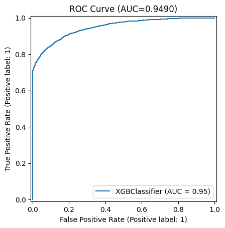
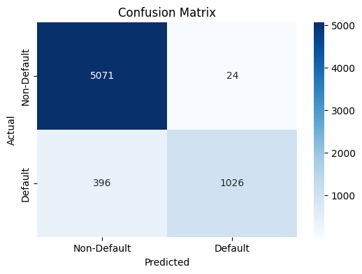
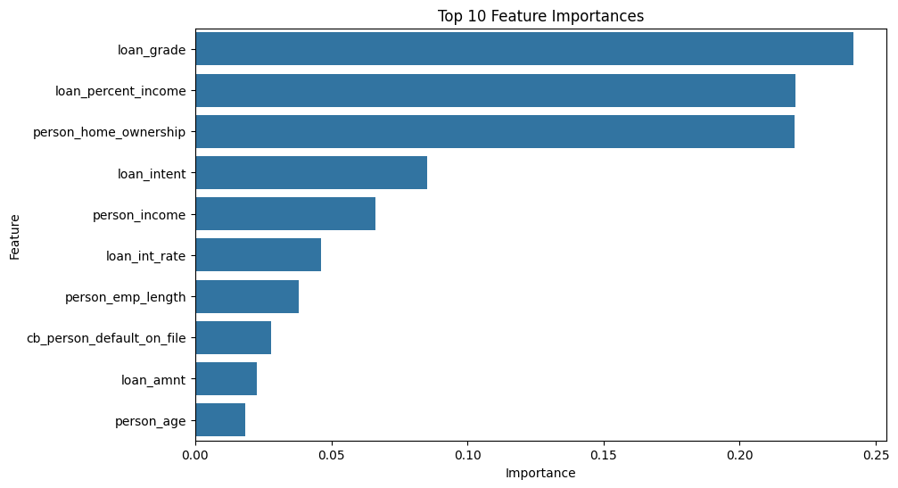
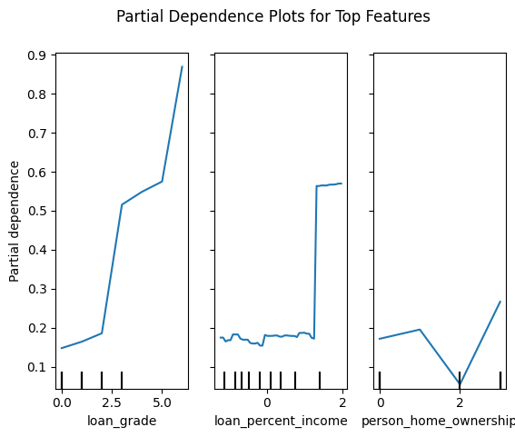
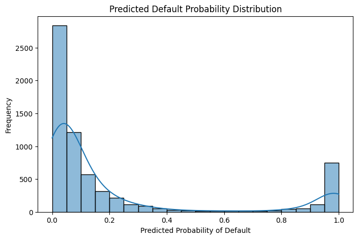
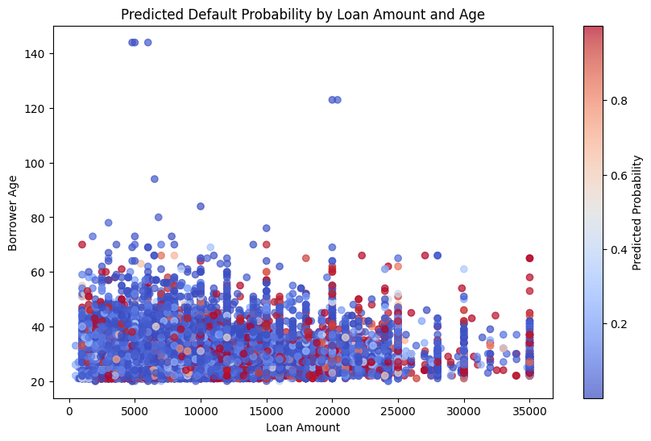
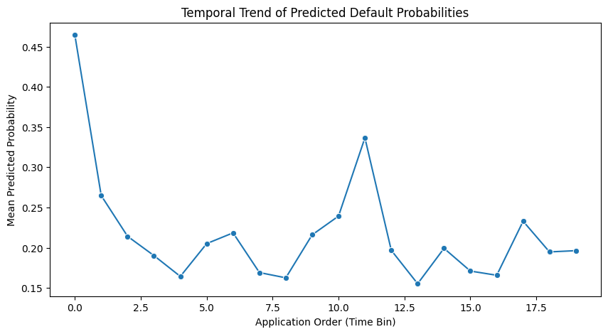
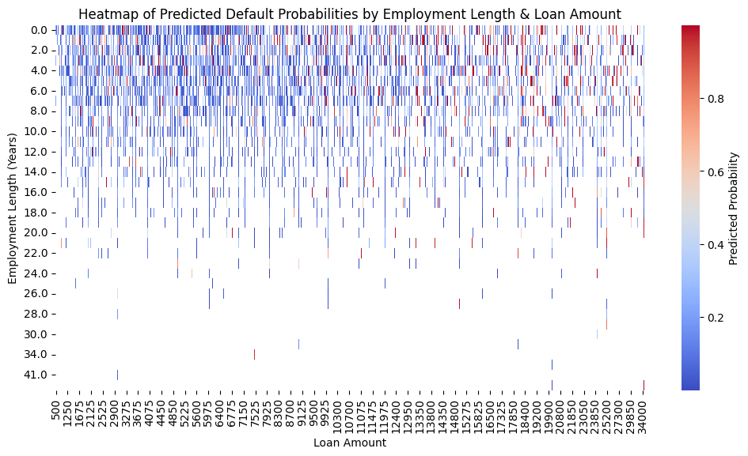
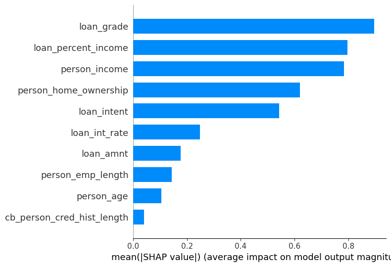
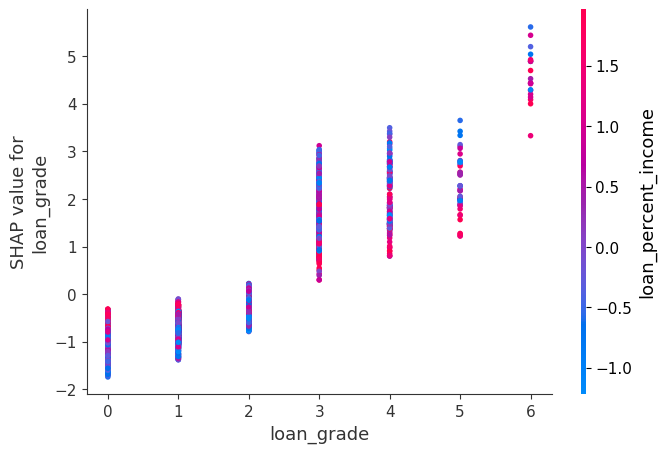

# Credit Risk Prediction Using Tree-Based Machine Learning

A supervised machine learning pipeline that predicts whether a borrower will **default on a loan**, using an XGBoost gradient-boosted tree classifier with full interpretability analysis (feature importance, partial dependence, SHAP).

> MSc Big Data Analytics, Programming for Data Science (Python), Victoria University Kampala



## Table of Contents
- [Overview](#overview)
- [Background](#background)
- [Dataset](#dataset)
- [Methodology](#methodology)
- [Results](#results)
- [Interpretability](#interpretability)
- [Strengths and Limitations](#strengths-and-limitations)
- [Proposed Enhancements](#proposed-enhancements)
- [Getting Started](#getting-started)
- [Reproducibility](#reproducibility)
- [References](#references)

## Overview

Accurately predicting loan default supports approval decisions, interest rate assignment and portfolio risk management. Misclassifying risky borrowers causes financial losses, while overly conservative models turn away creditworthy applicants.

This project:
- Replicates the analytical workflow of a published mortgage credit-risk study on a public dataset
- Builds an end-to-end Python pipeline from raw data to explainable predictions
- Tests the hypothesis below

| Hypothesis | Statement |
| --- | --- |
| **H₀** | Linear or basic models perform comparably to tree-based ensembles in predicting loan default. |
| **H₁** | Tree-based ensembles with structured feature engineering capture non-linear effects and interactions, giving superior accuracy and reliability. |

## Background

The work is based on Kündig and Sigrist (2025), who propose a tree-boosted spatio-temporal frailty model for mortgage default. Using Freddie Mac loan-level data (1999–2022, 538,942 mortgages across 875 regions) and the **GPBoost** library, they combine tree-boosting with a latent spatio-temporal Gaussian process. They report better predictive accuracy than linear hazard models, especially for extreme portfolio losses during stress periods such as the 2008 financial crisis.

This project follows the same analytical structure (preprocessing, linear vs. non-linear comparison, probabilistic evaluation, SHAP interpretation) on a smaller, publicly available individual-level dataset.

## Dataset

**Credit Risk Dataset** from [Kaggle](https://www.kaggle.com/datasets/laotse/credit-risk-dataset): individual loan applicants with demographic, financial and loan attributes.

| Type | Features |
| --- | --- |
| Numerical | `person_age`, `person_income`, `person_emp_length`, `loan_amnt`, `loan_int_rate`, `loan_percent_income`, credit history length |
| Categorical | `person_home_ownership`, `loan_intent`, `loan_grade`, `cb_person_default_on_file` |
| **Target** | `loan_status` (1 = default, 0 = non-default) |

## Methodology

The pipeline is modular and sequential:

1. **Load** the CSV and inspect for missing values or inconsistencies
2. **Impute** missing `person_emp_length` values with the median
3. **Encode** categorical variables with label encoding
4. **Scale** numerical features with `StandardScaler`
5. **Split** into training and test sets (stratified 80/20)
6. **Train** an XGBoost classifier with fixed hyperparameters and a log-loss objective
7. **Evaluate** on the held-out test set
8. **Interpret** with feature importance, partial dependence plots and SHAP
9. **Predict** on new data with a custom inference function that handles unseen categories and applies consistent scaling

**Libraries:** Pandas, NumPy, scikit-learn, XGBoost, SHAP, Matplotlib / Seaborn

## Results

**Evaluation metrics:** accuracy, per-class precision / recall / F1, confusion matrix, ROC curve and AUC.

| Metric | Value |
| --- | --- |
| ROC-AUC | **0.949** |
| Accuracy | ~93.6% |
| Default class precision | ~97.7% |
| Default class recall | ~72.2% |

*Accuracy, precision and recall are calculated from the confusion matrix below.*

<table>
  <tr>
    <td></td>
    <td></td>
  </tr>
</table>

The model separates default from non-default loans well (AUC 0.949). Most errors are missed defaults (396 false negatives), reflecting class imbalance rather than model instability.

## Interpretability

### Feature importance
The most influential predictors are **loan interest rate, loan amount, borrower income, credit history length and employment length**, which align with established credit risk theory.



### Partial dependence
Partial dependence plots show the marginal effect of the top features on predicted default probability.



### Predicted probability distribution


### Advanced visual analytics

| Predicted default probability vs. age and loan amount | Stability of predicted risk across application order |
| --- | --- |
|  |  |

**Interaction of employment length and loan amount**



### SHAP analysis
SHAP values give global and local explanations of the model's behaviour.

| Summary plot | Dependence plot (`loan_grade`) |
| --- | --- |
|  |  |

## Strengths and Limitations

**Strengths**
- Strong predictive performance with non-linear modelling
- Extensive interpretability (feature importance, PDPs, SHAP)
- Fully reproducible, modular, notebook-based implementation

**Limitations**
- Class imbalance reduces recall for default cases
- Label encoding imposes an artificial ordinal structure on categorical variables
- Temporal effects are approximated with a proxy variable rather than explicitly modelled

## Proposed Enhancements

Based on gaps identified in the source paper:
- Adaptive time-decay or outlier weighting to reduce the influence of anomalous events such as COVID-19
- Finer-resolution spatial data or hierarchical modelling for localised dependencies
- Flexible or non-stationary covariance functions for the latent Gaussian process
- Heavy-tailed or extreme-event components to model tail risk
- Richer predictors (high-frequency macroeconomic, regional or alternative data)
- GPU-accelerated or mini-batch boosting to reduce computational cost

## Getting Started

```bash
# 1. Clone the repository
git clone https://github.com/YOUR-USERNAME/YOUR-REPO.git
cd YOUR-REPO

# 2. Install dependencies
pip install pandas numpy scikit-learn xgboost shap matplotlib seaborn jupyter

# 3. Download the dataset from Kaggle and place the CSV in the project folder
#    https://www.kaggle.com/datasets/laotse/credit-risk-dataset

# 4. Launch the notebook
jupyter notebook
```

## Reproducibility

Random seeds are fixed, hyperparameters are explicit and outputs are generated deterministically, so results can be replicated under equivalent conditions.

## References

- Kaggle. (2023). *Credit risk dataset* [Dataset]. https://www.kaggle.com/datasets/laotse/credit-risk-dataset
- Kündig, P., & Sigrist, F. (2025). *A spatio-temporal machine learning model for mortgage credit risk: Default probabilities and loan portfolios.* Working paper.

## Author

**Registration No:** VU-MBD-2511-0152-WEE · Victoria University Kampala, Uganda
